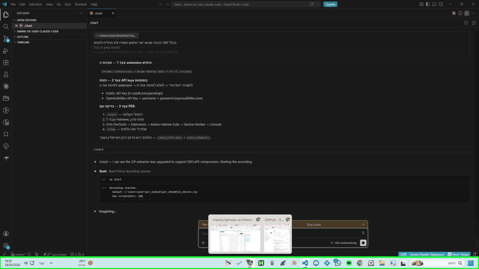

# PSR.ai

> Record any workflow once. Let AI agents understand it forever.



PSR.ai turns raw screen recordings into structured, machine-readable documentation in one command - preventing AI token bleeding, cutting API costs by up to 80%, and enabling autonomous self-healing pipelines across Windows, macOS, and Linux.

---

## Why PSR.ai

Every time you describe a workflow to an AI agent in free text, you waste tokens. PSR.ai captures the workflow visually, extracts a dense structured summary, and feeds it directly to any LLM - without burning context on narration.

| Problem | PSR.ai Solution |
|---|---|
| Describing workflows wastes tokens | Structured AI context block fits in one prompt |
| Manual screenshot annotation takes hours | `sa stop` generates everything automatically |
| Agents repeat the same mistakes | `sa heal` correlates failures with recorded steps |
| Sharing workflows exposes sensitive context | `sa review` purges private frames before publish |
| Reproducing bugs is hard to explain | `sa replay` re-executes the recording with Claude |

---

## Quick Start - 30 seconds

```bash
# Install (Python 3.10+ required)
pip install psr-ai

# Record a session - runs silently in the background
sa start

# ... perform any workflow you want to document ...

# Stop and auto-generate everything
sa stop
# Output:
#   Parsed:      12 steps extracted
#   Data:        psr_output/psr_20240115_143000_output/data.json
#   Screenshots: psr_output/psr_20240115_143000_output/screenshots/
#   Report:      psr_output/psr_20240115_143000_output/report.md
#   GIF:         psr_output/psr_20240115_143000_output/action_replay.gif

# Optional: publish to GitHub
sa pub psr_output/psr_20240115_143000_output --git
```

**Optional extras:**

```bash
pip install psr-ai[gif]   # GIF generation (Pillow)
pip install psr-ai[ai]    # AI vision analysis (Anthropic/OpenAI)
```

---

## Open-Core vs Enterprise Cloud

| Feature | Open-Core (Free) | Enterprise Cloud |
|---|---|---|
| Full-page screen capture | Yes | Yes |
| Structured JSON + Markdown output | Yes | Yes |
| Animated GIF replay | Yes | Yes |
| AI vision step descriptions | Yes (bring your own key) | Yes (managed) |
| Self-healing test integration | Yes | Yes |
| Playwright test generation | Yes | Yes |
| Session publish to GitHub | Yes | Yes |
| Central telemetry dashboard | - | Yes |
| Multi-tenant team scopes | - | Yes |
| Managed cloud storage | - | Yes |
| SLA + priority support | - | Yes |

Enterprise inquiries: open an issue or contact via GitHub.

---

## Platform Support

PSR.ai runs natively on all major operating systems:

| Platform | Recording Engine |
|---|---|
| Windows | `psr.exe` (built-in Steps Recorder) |
| macOS | `screencapture` + `osascript` |
| Linux | `gdbus` (Wayland) / `xwd` (X11) |

All platforms produce identical output: `data.json`, `report.md`, `action_replay.gif`, and a `screenshots/` directory.

---

## Command Reference

| Command | What it does |
|---|---|
| `sa start` | Start recording; terminal stays free |
| `sa start --maxsc 100` | Set max screenshot count (default: 100) |
| `sa stop` | Stop recording; auto-generate report + GIF |
| `sa stop --no-gif` | Stop and parse; skip GIF generation |
| `sa status` | Check whether recording is active |
| `sa capture <url>` | Full-page screenshot of any URL |
| `sa capture <url> --pdf` | Full-page PDF of any URL |
| `sa analyze <dir>` | Enrich steps with AI vision descriptions |
| `sa review <dir>` | Interactively drop sensitive frames |
| `sa replay <zip>` | Re-execute a session using Claude |
| `sa pub <dir>` | Copy session to docs/sessions/ |
| `sa pub <dir> --git` | Copy + git commit + push |
| `sa pub <dir> --github-api` | Push via GitHub Contents API |
| `sa heal` | Run tests + correlate failures with session |
| `sa testgen <dir>` | Generate Playwright integration test |
| `sa pipeline <zip>` | Full parse + analyze + publish pipeline |
| `sa watch "<trigger>" --action "<action>"` | Watch screen and react automatically |
| `sa agent "<task>"` | Let Claude autonomously fix a problem |

---

## Output Structure

```
psr_20240115_143000_output/
|- report.md            # AI context block + step timeline (GitHub Markdown)
|- data.json            # Structured JSON for LLM and agent consumption
|- action_replay.gif    # Animated replay with cursor highlight halos
|- screenshots/
   |- step_000.png
   |- step_001.png
   |- ...
```

---

## AI Agent Integration

### AI Context Block

`report.md` opens with a dense context block designed to fit in any LLM prompt:

```text
Session: My Workflow | Source: recording.zip | Steps: 12
STEP 000 | 2024-01-15 14:30:00 | Chrome | Left-click on Submit | screenshot:yes
STEP 001 | 2024-01-15 14:30:05 | Chrome | Type: search query   | screenshot:yes
```

### Feeding data.json to an agent

```json
{
  "title": "Session title",
  "source": "recording.zip",
  "generated_at": "2024-01-15T14:30:00+00:00",
  "step_count": 12,
  "steps": [
    {
      "index": 0,
      "label": "Click Submit",
      "timestamp": "2024-01-15 14:30:00",
      "program": "Chrome",
      "action_text": "Left-click on Submit",
      "screenshot": "screenshots/step_000.png"
    }
  ]
}
```

### Self-healing CI integration

```yaml
# .github/workflows/psr-self-healing.yml
- name: Run self-healing diagnostics
  run: sa heal --session psr_output/latest_output
```

---

## Architecture

```
src/psr_ai/
|- cli.py                # click command group: all sa commands
|- core/
|  |- recorder.py        # Screen recorder with multi-OS fallback resolution
|  |- parser.py          # Archive extraction and step parsing
|  |- generator.py       # MarkdownGenerator + GifGenerator
|  |- analyzer.py        # AI vision enrichment (Anthropic / OpenAI)
|  |- publisher.py       # Copy + git commit/push + GitHub API
|  |- capture.py         # Full-page URL capture (Playwright)
|  |- agent.py           # Autonomous Claude agent loop
|  |- replay.py          # Session replay engine
|  |- watcher.py         # Screen condition watcher
|  |- healer.py          # Test suite diagnostics
|  |- testgen.py         # Playwright test generation
|  |- pipeline.py        # End-to-end automation pipeline
|- ee/
|  |- client.py          # Enterprise: async cloud telemetry client
|  |- auth.py            # Enterprise: multi-tenant token authorization
|- utils/
   |- encoding.py        # Charset auto-detection with fallback chain
   |- paths.py           # Path utilities and filename sanitization
```

---

## Claude Desktop Integration (MCP)

PSR.ai ships a built-in MCP server that lets Claude Desktop call your local recording tools directly.

### 1. Locate the config file

| Platform | Path |
|---|---|
| Windows | `%APPDATA%\Claude\claude_desktop_config.json` |
| macOS | `~/Library/Application Support/Claude/claude_desktop_config.json` |

### 2. Add the server block

Open (or create) the file and add `psr-ai` under `mcpServers`:

```json
{
  "mcpServers": {
    "psr-ai": {
      "command": "python",
      "args": ["-m", "psr_ai.mcp"]
    }
  }
}
```

If you installed into a virtual environment, point `command` at the venv interpreter:

```json
{
  "mcpServers": {
    "psr-ai": {
      "command": "C:\\path\\to\\venv\\Scripts\\python.exe",
      "args": ["-m", "psr_ai.mcp"]
    }
  }
}
```

Alternatively, use the `sa mcp` console script if it is on your PATH:

```json
{
  "mcpServers": {
    "psr-ai": {
      "command": "sa",
      "args": ["mcp"]
    }
  }
}
```

### 3. Verify the connection

1. Restart Claude Desktop completely.
2. Open a new conversation.
3. Look for the hammer icon (tool indicator) in the chat input bar.
4. Click it and confirm you see `psr_start_recording`, `psr_stop_and_parse`, `psr_quick_snapshot`, and `psr_fetch_link` listed.

### 4. Optional: link fetching for social/video URLs

`psr_fetch_link` uses `yt-dlp` for YouTube/Instagram/TikTok content:

```bash
pip install yt-dlp
```

Generic web pages work with no extra dependencies.

---

## Development

```bash
# Install with all dev dependencies
pip install -e ".[dev,gif,ai]"

# Run the full test suite
pytest

# Verify the CLI
sa --help
```

---

## Known Constraints

- **Group Policy (Windows)**: `psr.exe` may be blocked on enterprise-managed machines. PSR.ai falls back to a bundled shortcut automatically.
- **GIF memory**: long recordings should use `--maxsc` to cap the screenshot count. Each frame is resized to 1280 px max before encoding.

---

## License

MIT - see [LICENSE](LICENSE) for the full text.

Copyright (c) 2024 Maio Eshet

---

*PSR.ai is not affiliated with Microsoft. Windows Steps Recorder is a Microsoft product.*
